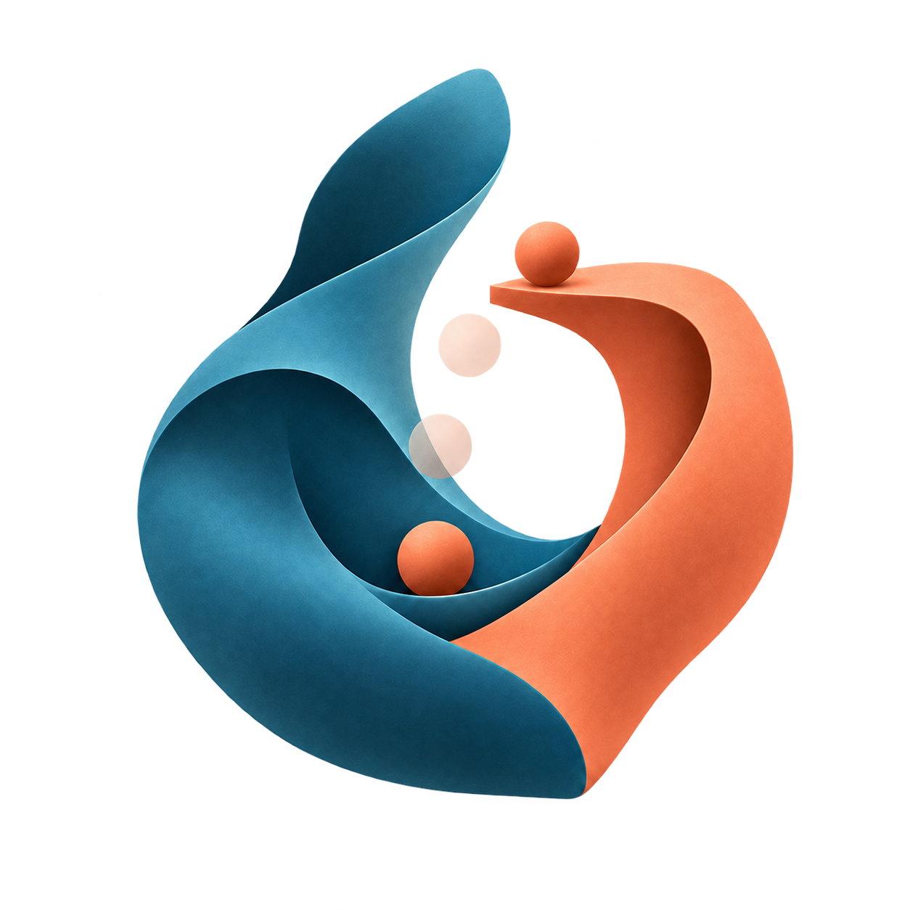
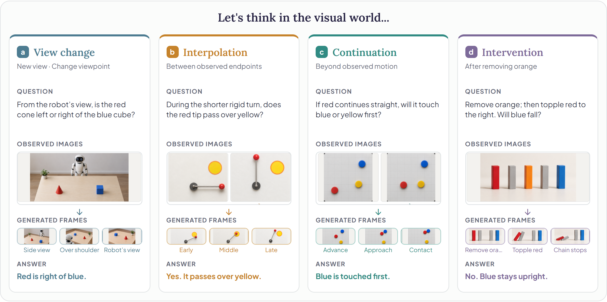
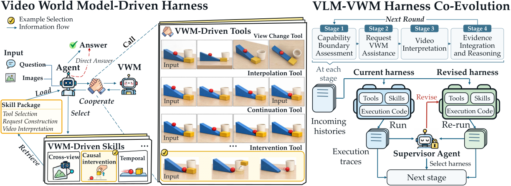

<a name="readme-top"></a>

<div align="center">
  
  <h1>CoWorld Reasoner: Agentic Multimodal Reasoning with the Evolving Video World Model-Driven Harness</h1>
  <a href="https://modalitydance.github.io/CoWorld-Reasoner/"></a>
  <a href="https://arxiv.org/abs/2610.21910"></a>
  <a href="https://huggingface.co/papers/2610.21910"></a>
  <a href="https://huggingface.co/datasets/ModalityDance/CoWorld-Reasoner-Dev"></a>
  <a href="./LICENSE"></a>
</div>

**CoWorld Reasoner** uses a video world model (VWM) to explore visual evidence
beyond the observed images. Its **Video World Model-Driven Harness** guides a
multimodal agent in requesting and interpreting this evidence to answer questions.
**VLM-VWM Harness Co-Evolution** improves the harness through stage-wise execution
feedback while keeping the weights of both models fixed.

### 🪐 Key Features

- **Unified visual reasoning engine.** One video world model supports diverse visual reasoning needs.
- **Agentic visual imagination.** The agent decides whether to imagine, which operation to request, and how to use the resulting evidence.
- **Evolving harness.** Execution experience improves VLM–VWM interaction by actively revising the agent harness.

<div align="center">
  <a href="https://modalitydance.github.io/CoWorld-Reasoner/#abstract"></a>
  <p><em>Thinking beyond observed images through video world models.</em></p>
</div>

## 🔥 News

- **[2026.10]** Our [paper](https://arxiv.org/abs/2610.21910) is now available on arXiv.
- **[2026.10]** Released the code, evolved harness, and [development data](https://huggingface.co/datasets/ModalityDance/CoWorld-Reasoner-Dev).

## 📑 Table of Contents

- [🚀 Quick Start](#quick-start)
  - [1. Installation](#installation)
  - [2. Data](#data)
  - [3. Running](#running)
    - [Evolved harness](#evolved-harness)
    - [Evaluation](#evaluation)
    - [Co-evolution](#co-evolution)
- [🧪 Usage Example](#usage-example)
- [✨ How It Works](#how-it-works)
- [🌱 Acknowledgements](#acknowledgements)
  - [🔗 Related Projects](#related-projects)
- [📚 Citation](#citation)

## 🚀 Quick Start <span id="quick-start"></span>

### 1. Installation <span id="installation"></span>

Requirements: Python 3.10+, Git, Node.js 20+, and the Codex CLI.
Models run through hosted VLM and FAL APIs; no local GPU is required.

```bash
git clone https://github.com/ModalityDance/CoWorld-Reasoner.git
cd CoWorld-Reasoner
python -m venv .venv
```

Activate the virtual environment, then install the dependencies:

```shell
python -m pip install -r requirements.txt
npm install -g @openai/codex@0.153.4
```

Copy `.env.example` to `.env` and set:

| Variable | Value |
| --- | --- |
| `AGENTIC_VLM_BASE_URL` | Your OpenAI-compatible endpoint |
| `AGENTIC_VLM_API_KEY` | Its API key |
| `AGENTIC_VLM_MODEL` | Your model deployment |
| `FAL_KEY` | Your FAL API key for MiniMax H3 Max Turbo |

> [!NOTE]
> Use an OpenAI-compatible endpoint with the Responses API, image input, function calling, and structured JSON output.

The answer judge uses the same model and endpoint by default;
`COEVOLVE_JUDGE_*` settings override them.

### 2. Data <span id="data"></span>

#### Development data

The [development data](https://huggingface.co/datasets/ModalityDance/CoWorld-Reasoner-Dev)
contain 30 examples each from MMSI-Bench, SpinBench, CausalSpatial, and PerceptionBench,
with 244 images. Download them from the repository root:

```shell
python scripts/prepare/download.py
```

Questions are in `data/dev120/public.jsonl`; reference answers are in
`scorer_bundle/data/dev120_evaluator_only.jsonl`.

#### Benchmark evaluation

Download the original benchmarks linked below and exclude the development items,
matching questions and ordered images against `data/dev120/public.jsonl`.

| Benchmark | Development items excluded | Evaluation items | Answer format |
| --- | ---: | ---: | --- |
| [MMSI-Bench](https://arxiv.org/abs/2505.23764v3) | 30 | 970 | Multiple choice |
| [SAT](https://arxiv.org/abs/2412.07755) | 0 | 300 | Multiple choice |
| [SpinBench](https://arxiv.org/abs/2509.25390) | 30 | 2,709 | Multiple choice |
| [SpatiaLab](https://arxiv.org/abs/2602.03916) | 0 | 1,400 per format | Multiple choice / Open answer |
| [ERQA](https://arxiv.org/abs/2503.20020) | 0 | 400 | Multiple choice |
| [CausalSpatial](https://arxiv.org/abs/2601.13304) | 30 | 1,395 | Multiple choice |
| [PerceptionBench](https://arxiv.org/abs/2607.24957) | 30 | 2,970 | Benchmark question format |

SAT uses two option permutations per question, each with its own ID and reference
letter. SpatiaLab evaluates the same questions in MCQ and Open formats.

#### Input format

Create an input JSONL file with one task per line. Preserve the original
question, option order, and ordered image references. Use unique, filename-safe
sample IDs; image paths are relative to `--input-root` or absolute.

```json
{"sample_id":"scene-001","benchmark":"Example","question":"Compare Picture 1 and Picture 2. Which object moved? A. cup B. box","image_paths":["images/before.jpg","images/after.jpg"]}
```

Array order defines Picture 1, Picture 2, and the tools' zero-based source indices.
For interleaved text and images, set `"interleaved_observations": true` and place
`[[observed_00]]`, `[[observed_01]]`, etc. at the corresponding positions in the question.

Store reference answers in a separate JSONL file with matching sample IDs:

```json
{"sample_id":"scene-001","benchmark":"Example","question":"Compare Picture 1 and Picture 2. Which object moved? A. cup B. box","answer":"B","score_spec":{"type":"normalized_exact_match"}}
```

| Answers | `score_spec.type` |
| --- | --- |
| Multiple choice | `normalized_exact_match` |
| PerceptionBench | `perceptionbench_official_general_qa_judge_v1` |
| SpatiaLab Open | `extended_short_answer_judge_v1` |

PerceptionBench uses option matching when possible and a general-QA judge otherwise;
SpatiaLab Open uses semantic-equivalence judging.

### 3. Running <span id="running"></span>

#### Evolved harness <span id="evolved-harness"></span>

> [!TIP]
> Start with the released `evolved_harness/` using Evaluation below. Co-evolution is optional.

The harness contains the reusable skills, stage guidance, visual tools, and
verifier; `runtime/` carries ordered histories and media between stages.

By default, each task can make one VWM generation request. `--retakes 1` allows
one additional attempt for the same operation.

#### Evaluation <span id="evaluation"></span>

Evaluate all 120 development examples with the evolved harness:

```shell
python -m experiments.evaluate --input-jsonl data/dev120/public.jsonl --input-root data/dev120 --output-root runs/eval --env-file .env
```

Development examples are scored using the downloaded reference answers. For other
benchmarks, supply a reference-answer JSONL file:

```shell
python -m experiments.evaluate --input-jsonl data/benchmarks/mmsi/public.jsonl --input-root data/benchmarks/mmsi --evaluator-jsonl data/benchmarks/mmsi/evaluator.jsonl --output-root runs/mmsi --env-file .env
```

Reference answers are optional for custom inputs; provide them to compute scores.

Final answers are in `p4/records.jsonl`; `p4/SCORING.json` contains per-sample
scores and aggregate accuracy. The paper's overall average is item-weighted:
sum correct counts across all eight evaluation columns and divide by their total item count.

Set `--workers N` to adjust concurrency. Use a new output directory when changing
the input or model configuration; see `--help` for the available options.

#### Co-evolution <span id="co-evolution"></span>

To further evolve the harness on development data:

```shell
python -m experiments.co_evolution --input-jsonl data/dev120/public.jsonl --input-root data/dev120 --output-root runs/coevolve --env-file .env
```

The default is three rounds. Use `--evolution-rounds 1` for one complete round.
The supervisor inspects completed interactions, revises the harness, and evaluates
candidates at each stage before carrying the selected candidate into the next stage.

> [!NOTE]
> In this example, co-evolution starts from the released harness and updates the local copy for subsequent evaluation.

Candidate harnesses, execution records, and scores are saved in the output directory.
Resume an interrupted run with `--resume`.

## 🧪 Usage Example <span id="usage-example"></span>

Try one development example from Python after configuring `.env` and downloading the data:

```python
import json
from pathlib import Path

from experiments.evaluate import evaluate

task = Path("data/dev120/public.jsonl").read_text(encoding="utf-8").splitlines()[0]
input_file = Path("runs/example/input.jsonl")
input_file.parent.mkdir(parents=True, exist_ok=True)
input_file.write_text(task + "\n", encoding="utf-8")

evaluate(input_file, "data/dev120", "runs/example/eval")

record = json.loads(Path("runs/example/eval/p4/records.jsonl").read_text(encoding="utf-8"))
print(record["stage_output"])
```

## ✨ How It Works <span id="how-it-works"></span>

1. **Video World Model-Driven Harness.** Tools expose visual operations, while skills guide the agent in deciding when to generate, constructing requests, and interpreting visual evidence to answer the question.
2. **VLM–VWM Harness Co-Evolution.** A supervisor uses execution feedback to revise tools, skills, and execution code, passing the selected harness and histories to the next stage while keeping both model weights fixed.

<div align="center">
  <a href="./docs/assets/method.svg"></a>
  <p><em>Overview of the Video World Model-Driven Harness and VLM–VWM Harness Co-Evolution.</em></p>
</div>

## 🌱 Acknowledgements <span id="acknowledgements"></span>

We thank the authors and maintainers of the benchmarks and video world
models used in this project:

[](https://arxiv.org/abs/2505.23764v3)
[](https://arxiv.org/abs/2412.07755)
[](https://arxiv.org/abs/2509.25390)
[](https://arxiv.org/abs/2602.03916)
[](https://arxiv.org/abs/2503.20020)
[](https://arxiv.org/abs/2601.13304)
[](https://arxiv.org/abs/2607.24957)
[](https://www.minimax.io/blog/minimax-h3)
[](https://arxiv.org/abs/2501.00103)

Code is distributed under the [MIT license](LICENSE). Third-party models,
datasets, and dependencies retain their own licenses.

### 🔗 Related Projects <span id="related-projects"></span>

[](https://openaccess.thecvf.com/content/CVPR2026/html/Tong_Thinking_with_Video_Video_Generation_as_a_Promising_Multimodal_Reasoning_CVPR_2026_paper.html)
[](https://aclanthology.org/2026.findings-acl.1937/)
[](https://papers.nips.cc/paper_files/paper/2025/file/9e3b203e72c4e058de26d02a92a81844-Paper-Conference.pdf)
[](https://arxiv.org/abs/2602.08236v2)

## 📚 Citation <span id="citation"></span>

Please cite our paper as:

```bibtex
@misc{cheng2026coworldreasoner,
  title  = {CoWorld Reasoner: Agentic Multimodal Reasoning with the Evolving Video World Model-Driven Harness},
  author = {Dongjie Cheng and Ruifeng Yuan and Ran Wei and Ning Song and Yongqi Li and Wenjie Li},
  year   = {2026},
  eprint = {2610.21910},
  archivePrefix = {arXiv},
  primaryClass = {cs.AI},
  url    = {https://arxiv.org/abs/2610.21910}
}
```

<div align="center">
  <a href="https://github.com/ModalityDance/CoWorld-Reasoner"></a>
  <a href="https://github.com/ModalityDance/CoWorld-Reasoner/issues"></a>
</div>
